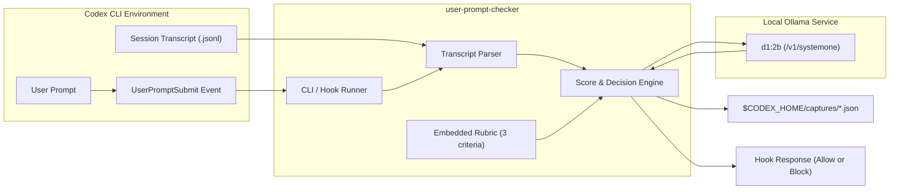
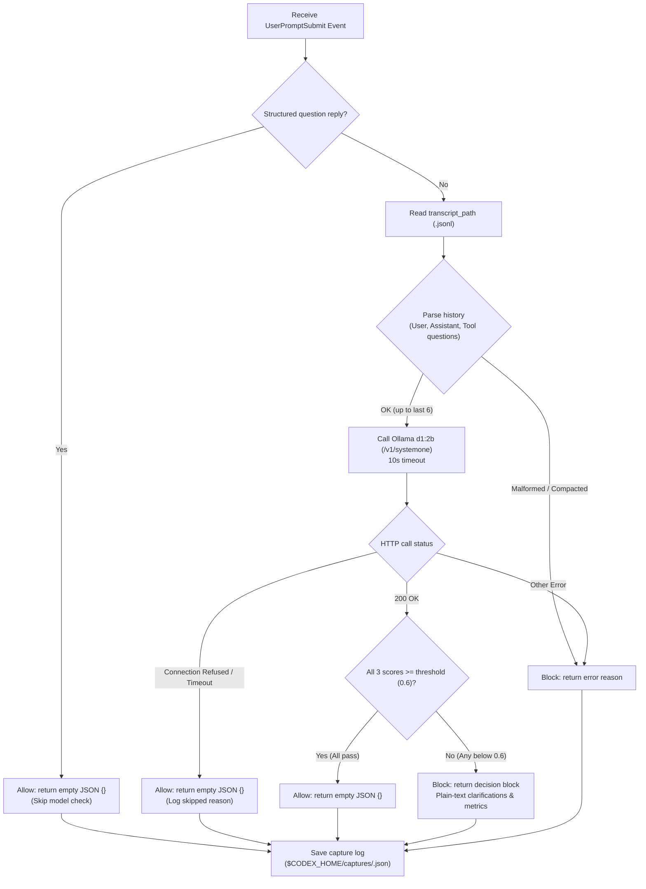

# user-prompt-checker

A standalone Go CLI and agent lifecycle hook (supporting both OpenAI Codex and Google Antigravity / AGY) that checks user prompts and optional conversation history against three criteria in a single Ollama `d1:2b` `/v1/systemone` API call.
The default rubric is embedded directly into the binary.

## Build and Install

Toolchains are managed via `mise` (`mise.toml`), and project tasks are managed via `just` (`justfile`).
Ensure Ollama is running at `http://localhost:11434` with `d1:2b` available:

```sh
# Verify Ollama status and d1:2b model availability:
just ollama::status
# Pull d1:2b if not yet installed:
just ollama::pull
```

```sh
# Build and test using just:
just build
just test

# Or using standard Go commands:
go build -o user-prompt-checker ./cmd/user-prompt-checker
# Or install to GOBIN / GOPATH/bin:
go install ./cmd/user-prompt-checker
```

Run `just --list` to view all available tasks.

## Usage

```sh
# Quick check via CLI (or `just check '<prompt>'`):
./user-prompt-checker check 'Change the background color of the submit button on the login screen to #0066cc.'
./user-prompt-checker check 'Proceed with that.' --history history.json

# Run evaluation benchmark:
just evaluate
# or: ./user-prompt-checker evaluate

# Analyze prompt score improvements and quality history (interactive TUI dashboard on terminal):
just gain
# or: ./user-prompt-checker gain [--format text|json]
```

`check` returns the three scores, pass/block decision, failed criteria, clarification prompts, and elapsed time as JSON.
The exit code is `0` when the check completes (even if `pass` is `false`), `1` on network or input errors, and `2` on invalid CLI flags.
Check the `pass` field in the JSON output to determine whether the prompt passed.

`evaluate` runs all cases in `cases.yaml` in fixed order, prints per-case scores and summary metrics, and writes the full report (inputs, rubric, raw model responses, latency) to `results.json`.
Specify `--output <path>` to save to another file or `--threshold <float>` to test a different threshold:

```sh
./user-prompt-checker --threshold 0.7 evaluate --output results-070.json
```

`history.json` is a chronological array of prior messages (excluding the current prompt):

```json
[
  {"role": "user", "content": "I want to make the submit button on the login screen blue."},
  {"role": "assistant", "content": "How about changing the background color to #0066cc?"}
]
```

## How It Works

### Architecture



### Hook Evaluation Flow



## Evaluation Criteria

`internal/checker/rubric.json` (embedded by default, overrideable via `--rubric`) defines three independent criteria evaluated in English:

| Criterion | What it checks |
| --- | --- |
| `intent_clear` | Whether the prompt expresses an action, question, or conversational reply rather than a bare noun phrase or ungrounded continuation |
| `context_sufficient` | Whether the subject and desired outcome are identifiable from the prompt and conversation without guessing missing targets or unchosen options |
| `consistent` | Whether active requirements are logically compatible (an explicit latest correction supersedes an older requirement) |

User input can be in any language supported by `d1:2b` (current test cases cover Japanese and English; broader multilingual accuracy has not been independently verified).
Each score is the raw `noul` value returned by `/v1/systemone`.
If any score is below `--threshold` (default `0.6`), the prompt is marked `pass: false`.
A score equal to the threshold passes.

## Evaluation Scope and Limitations

`cases.yaml` includes explicit requests, missing references, bare noun phrases, vague quality requests, conflicting constraints, harmless typos, option selection, requirement corrections, exploratory brainstorming, prompt injection attempts, and real follow-up prompts captured from Codex sessions.

Expected values in `cases.yaml` are provisional hypotheses rather than independently calibrated ground truth.
When changing the rubric or threshold, validate against held-out examples rather than treating `cases.yaml` match counts as independent accuracy.
Reported latency includes HTTP round-trip time with the model warm in memory; cold loads and long transcripts are not guaranteed to match.

Model specification: [Ollama d1:2b](https://ollama.com/library/d1:2b)

## Agent Hook Integration

The `hook <agent>` subcommand adapts to the lifecycle hook protocol of the specified agent (`codex` or `agy`). The `<agent>` argument is required.

You can automatically register or remove the hooks using `install` / `uninstall`:
```sh
# Automatic setup (creates .bak backup and safely merges into existing hooks.json):
just install agy      # or: ./user-prompt-checker install agy
just install codex    # or: ./user-prompt-checker install codex

# To remove:
just uninstall agy    # or: ./user-prompt-checker uninstall agy
just uninstall codex  # or: ./user-prompt-checker uninstall codex
```

### 1. Codex CLI Hook Integration (`hook codex`)

The `hook codex` command reads a `UserPromptSubmit` JSON event from stdin and reads `transcript_path` to extract up to the last 6 messages (`user` messages with `user` provenance, `assistant` `final_answer` messages, and `request_user_input_async` tool questions from prior turns).
Structured tool replies (`<send_user_message_question_reply>...</send_user_message_question_reply>`) automatically skip model evaluation and pass through.

- **When all scores >= 0.6**: outputs `{}` with no notification.
- **When any score < 0.6**: outputs `{"decision": "block", "reason": "..."}` containing plain-text clarification bullets for the failed criteria followed by all three scores and the threshold (no ANSI escape sequences, as Codex CLI `0.166.0` renders raw escape codes).
- **When Ollama is unreachable or times out** (default hook timeout: 10s): skips the check, logs the skip reason, and outputs `{}` so normal work is not blocked.
- **On transcript format or non-network errors**: returns `{"decision": "block"}` with the error reason.

Each hook invocation writes a capture record (with `0600` permissions in `$CODEX_HOME/captures/<uuid>.json`, defaulting to `~/.codex/captures/`) containing the event, transcript snapshot, extracted history, scores, and hook response.

#### Installing in `~/.codex/hooks.json`

To enable the hook in your normal Codex environment, build the binary and register `<path-to-binary>/user-prompt-checker hook codex` under `UserPromptSubmit` in `~/.codex/hooks.json`:

```json
{
  "hooks": {
    "UserPromptSubmit": [
      {
        "hooks": [
          {
            "type": "command",
            "command": "/path/to/user-prompt-checker hook codex",
            "timeout": 15,
            "statusMessage": "Checking user prompt with local d1"
          }
        ]
      }
    ]
  }
}
```

After updating `hooks.json`, run `/hooks` inside Codex CLI to review and trust the hook.
Transcript parsing relies on the private JSONL format observed in Codex CLI `0.166.0`; compacted transcripts, image inputs, and future CLI schema changes require separate verification.
Hook protocol reference: [OpenAI Hooks Documentation](https://learn.chatgpt.com/docs/hooks)

### 2. Antigravity Hook Integration (`hook agy`)

The `hook agy` command integrates with Antigravity as a `PreInvocation` lifecycle hook.
It receives the hook payload via stdin, extracts the prompt from `lastUserInput` (stripping enclosing `<USER_REQUEST>` wrappers if present), and parses prior `USER_INPUT` and `PLANNER_RESPONSE` turns from `transcriptPath`.

- **When all scores >= 0.6**: outputs `{}` to allow the agent execution to proceed normally.
- **When any score < 0.6**: outputs:
  ```json
  {
    "terminationBehavior": "terminate",
    "injectSteps": [
      {
        "errorMessage": {
          "userMessage": "- Specify the target...\n\nIntent clarity ...\nThreshold ..."
        }
      }
    ]
  }
  ```
  This halts execution before model invocation and displays the guidance message to the user.
- **When Ollama is unreachable or times out**: outputs `{}` and skips the check without blocking the user.

#### Installing in AGY (`hooks.json`)

To enable the hook in AGY, register it in your workspace `.agents/hooks.json` or global `~/.gemini/config/hooks.json`:

```json
{
  "user-prompt-checker": {
    "PreInvocation": [
      {
        "type": "command",
        "command": "/path/to/user-prompt-checker hook agy",
        "timeout": 15
      }
    ]
  }
}
```
